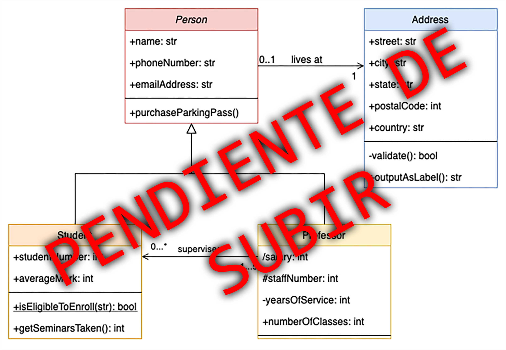

# Frogger en consola (C#)

Versión del clásico Frogger que se juega en la consola de Windows. Es una práctica del módulo M05 (Entornos de desarrollo) del ciclo DAM en Campus.NET Barcelona, curso 2022-2023.

El objetivo de la práctica era partir de un diseño en UML y una base de clases y convertirlos en un juego que funcione: cruzar la carretera y el río sin chocar con un coche ni caer al agua.



## Qué parte desarrollé yo

El profesor dio la base del proyecto: las clases `Element`, `Lane`, `Utils` y `TimeManager`, y el diagrama inicial. Mi trabajo fue:

- **Bucle principal del juego (`Program.cs`, clase `FroggerGame`).** Genera las 13 filas del mapa, alternando carriles de coches y troncos. En cada fotograma dibuja la escena, lee la tecla pulsada y actualiza la partida.
- **Estados de partida.** Detecto victoria y derrota con el enum `GAME_STATE` y, al terminar, ofrezco jugar otra vez sin cerrar el programa.
- **Diagrama UML final (`UML.png`).** Muestra las relaciones entre `Player`, `DynamicElement`, `Lane` y el resto de clases.

## Conceptos que practica

- Programación orientada a objetos: herencia (`Element` → `DynamicElement` → `Player`), encapsulación y sobrecarga de operadores en `Vector2Int`.
- Un bucle de juego en tiempo real con control de fotogramas (`TimeManager`, `Stopwatch`).
- Documentar el diseño con UML antes de programar.

## Cómo ejecutarlo

Necesitas el [SDK de .NET](https://dotnet.microsoft.com/download). El proyecto está hecho para .NET Core 3.1. Con un SDK más reciente puedes cambiar `TargetFramework` en el `.csproj` (por ejemplo, a `net8.0`).

```bash
git clone https://github.com/Jandri2001/M05_UF3_P3_Frogger.git
cd M05_UF3_P3_Frogger/M05_UF3_P3_Frogger
dotnet run
```

Se juega con las flechas del teclado o con W, A, S y D. La consola tiene que ser lo bastante grande para que quepa el mapa.

## Autor

Alejandro Bofarull Blanco · [LinkedIn](https://www.linkedin.com/in/alejandro-bofarull-blanco-905448305/)
